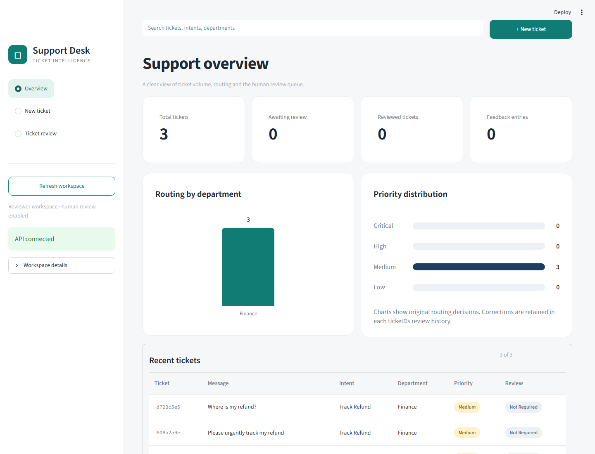
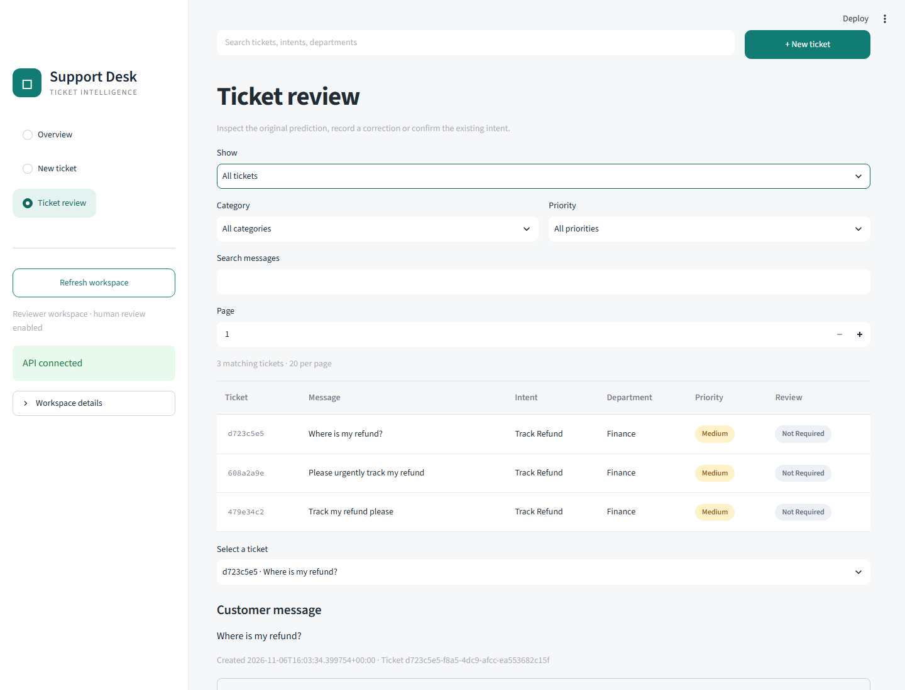
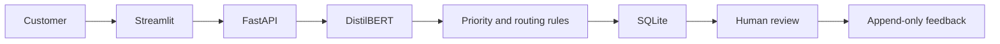

# Intelligent Customer Support Classifier

**Creator and project owner: [Abdul Wahab Munir](https://github.com/AbdulWahabMunir)**

A deployed NLP portfolio platform: classify support intents with fine-tuned DistilBERT, map categories, apply separate routing/priority rules, and collect human feedback.

**[Live application](https://aw-intelligent-customer-support.streamlit.app)** · [Final report](docs/final_report.md) · [Original brief audit](docs/requirements_audit.md)

## Current state

Dependency files are deliberately limited to two: **`requirements.txt`** runs the complete application (including CPU DistilBERT on Linux), while **`requirements-dev.txt`** includes it and adds notebook/validation/browser tools. Docker and Streamlit Community Cloud use the shared root file. Old component-specific manifests and Windows lock snapshots have been removed; transitive dependencies are not fully locked.

Release **1.1.1 is live and browser-verified**. Streamlit Community Cloud runs the frontend and an internal FastAPI/DistilBERT process; Neon PostgreSQL preserves tickets and feedback. The pre-update reviewed ticket remained available after the cloud API was replaced. Source and the approved model bundle are published on GitHub. See [deployment setup](community_full/README.md) and [project status](docs/project_status.md).

Implemented: reproducible Bitext download, EDA, duplicate removal, stratified train/validation/test splits, TF-IDF baselines, full three-epoch DistilBERT fine-tuning, saved models and local predictions.

FastAPI serves predictions, stores tickets in SQLite locally or PostgreSQL in the live app, and collects append-only corrections. Original decisions are preserved; feedback stays pending and never triggers automatic retraining.

The dashboard provides submission/results, review history, category/priority filters, message search, pagination, routing/priority charts and latest-review correction analytics.

The download and inspection use Python's standard library. Baselines and Transformers use the tested project virtual environment on Python 3.14.

From PowerShell in this folder:

```powershell
python -m src.data.download
python -m src.data.inspect
Start-Process reports/eda_report.html
python -m unittest discover -s tests -v
```

For baseline training (no environment activation required):

```powershell
python -m venv .venv
.venv\Scripts\python.exe -m pip install -r requirements.txt
.venv\Scripts\python.exe -m src.data.prepare
.venv\Scripts\python.exe -m src.train_baselines
.venv\Scripts\python.exe -m src.predict "I need to track my refund"
.venv\Scripts\python.exe -m unittest discover -s tests -v
```

Install `requirements.txt` for the complete application or `requirements-dev.txt` for notebook/development tools. Direct dependencies are pinned; this is not a full transitive lockfile. See `reports/baselines/comparison.md` for measured results and `reports/baselines/metrics.json` for per-class metrics. Processed splits, model files and error messages stay in ignored local directories. Only load joblib model files you trust.

The selected model is chosen by validation macro F1. Test scores are calculated after selection, and must not guide tuning. Probabilities printed by the prediction command are uncalibrated scores, not established reliability estimates.

## Error analysis and DistilBERT experiment

See [baseline error analysis](reports/baselines/error_analysis.md) and the [DistilBERT experiment guide](docs/distilbert_experiment.md). The transformer uses the existing splits and a pinned pretrained model revision. Full three-epoch training completed locally on CPU in approximately 55 minutes, with validation macro F1 of 0.9971. The exported checkpoint passed a reload/inference check.

Held-out results: **99.86% accuracy, 0.9983 macro F1**, with 5 errors among 3,642 test tickets. Logistic Regression scored 98.96% accuracy and 0.9885 macro F1. DistilBERT averaged 35.62 ms per message versus 1.53 ms for Logistic Regression in the same CPU evaluation process. See the [full comparison](reports/distilbert/comparison.md). These results describe synthetic Bitext data; real-ticket robustness and confidence calibration remain untested.

```powershell
.venv\Scripts\python.exe -m pip install -r requirements.txt
.venv\Scripts\python.exe -m src.analyze_errors
.venv\Scripts\python.exe -m src.train_distilbert --smoke --cpu
.venv\Scripts\python.exe -m src.package_colab
```

Use the completed local checkpoint:

```powershell
.venv\Scripts\python.exe -m src.predict_distilbert "I need to track my refund"
```

The optional `notebooks/02_distilbert_colab.ipynb` supports repeating the experiment on a Colab GPU. It accepts the generated private archive and downloads the final model and reports. Colab itself has not been launched.

The downloader needs internet access. The inspector can also read an existing CSV with `--input path/to/file.csv`. Reports use only aggregate values, not customer messages.

## Route a ticket

```powershell
.venv\Scripts\python.exe -m src.route_ticket "I need to track my refund"
```

The default model is the completed DistilBERT checkpoint; add `--model logistic_regression` to use the baseline. The response includes department, rule-based priority, review reasons, model/policy versions and latency. All 27 intents have configured routes; uncertain predictions go to human review. See the [routing policy](docs/routing_policy.md) for provisional score thresholds and incident/security overrides.

## Run the API

```powershell
.venv\Scripts\python.exe -m pip install -r requirements.txt
.venv\Scripts\python.exe -m uvicorn app.api:app --host 127.0.0.1 --port 8000
```

Open http://127.0.0.1:8000/docs. Submit `{"text": "I need to track my refund"}` to `POST /tickets`, then use its ID with `POST /tickets/{id}/feedback` to record a correction. SQLite data stays in the ignored `data/runtime` directory. The API also supports prediction without persistence, ticket retrieval, pagination, a review queue and aggregate analytics. See the [API guide](docs/api.md) for request bodies and review semantics.

The backend's real HTTP flow with DistilBERT confirmed ticket persistence, review handling, append-only feedback and original-prediction preservation. See [API verification evidence](reports/api/verification.md).

## Open the dashboard

With the API running in one terminal, run these in a second terminal:

```powershell
.venv\Scripts\python.exe -m pip install -r requirements.txt
.venv\Scripts\python.exe -m streamlit run app/dashboard.py
```

Open http://127.0.0.1:8501. Use New ticket to submit a message, Ticket review to inspect/correct predictions, and Overview to monitor activity. See the [dashboard guide](docs/dashboard.md). This is a local single-user application.

All **50 tests** passed, including filters/search, correction analytics, API authentication and hosted login behavior. Actual DistilBERT + PostgreSQL passed long-input/restart checks under a 512 MiB container limit. Live Edge verification confirmed application 1.1.1, the new controls and preserved reviewed tickets. See [live verification](reports/deployment/live-updated-verification.json).

### Dashboard previews

The current design, captured locally with synthetic demo tickets.





Additional deliverables: executed [EDA](notebooks/01_data_exploration.ipynb) and [comparison](notebooks/03_model_comparison.ipynb) notebooks, [BANKING77 experiment](reports/banking77/report.md), [template-similarity audit](reports/similarity_audit.json), and [API latency/edge-case report](reports/api/performance.json).


## Robustness and containers

A fixed **108-case robustness pilot** covers all 27 intents under paraphrasing, spelling swaps and polite wrappers. Both models were evaluated without retraining. DistilBERT scored 88.9% on draft anchor examples and 77.8% on draft paraphrases; these labels await human review and are not an independent benchmark. Read the [pilot report](reports/robustness-pilot/report.md) and [review protocol](docs/robustness.md).

```powershell
.venv\Scripts\python.exe -m src.evaluate_robustness
```

`Dockerfile` and `compose.yaml` define separate CPU API and dashboard containers, a read-only model mount and persistent SQLite volume. Docker Desktop 4.98.0, CLI 29.9.2 and Compose 5.6.1 are installed. Compose schema and CLI validation passed. Windows was upgraded to build 26300. Both images built and container prediction, feedback, restart persistence and dashboard health passed. With Docker Desktop running:

```powershell
.venv\Scripts\python.exe scripts/verify_containers.py
```

The container dashboard uses http://127.0.0.1:8502 and API docs use http://127.0.0.1:8002/docs, preserving the local Python ports. See the [container guide](docs/containers.md) for requirements and verification limits. The live deployment is verified; see the final report.

## Release and deployment

Start the local app with `.venv\Scripts\python.exe scripts/start_project.py`. Create the source/model ZIP archives and checksum manifest with `.venv\Scripts\python.exe -m src.package_release`. See [deployment instructions](docs/deployment.md), [project status](docs/project_status.md), and the [model card](docs/model_card.md).

`render.yaml` is schema-validated and proposes one password-protected service with persistent SQLite storage. It is not deployed, and no paid resources were created. An accessible GitHub repository and model artifact HTTPS URL/checksum are required. The hosted supervisor and login gate were verified locally against an isolated database.

Raw confidence diagnostics are in the [confidence report](reports/confidence/report.md). No calibrator was fitted; the measured raw-score ECE depends on the synthetic test distribution and does not imply real-world confidence reliability.



## Data and methodology

Source: [Bitext customer support dataset](https://huggingface.co/datasets/bitext/Bitext-customer-support-llm-chatbot-training-dataset). The download is pinned to revision `430d1a89bd93bd1fa23c16f29dd53e73f0087443`. The downloaded dataset card and SHA-256 manifest live beside the raw CSV. The dataset card identifies the license as CDLA-Sharing-1.0; consult its terms before sharing raw or derived data. Raw data is excluded from version control.

- Model input: `instruction` only. `response` is excluded to prevent answer leakage.
- Supervised targets: the dataset's original `intent` and `category` labels.
- Normalize case and whitespace only for duplicate auditing; preserve the raw text.
- Report missing values in all columns; label distributions use valid input/target rows.
- Remove normalized duplicate messages, reject conflicting labels, and stratify 70/15/15 by intent with seed 42. Check for normalized text overlap. Fit TF-IDF on training data only. Preserve punctuation and stopwords (including negation).
- The data contains generated linguistic variations. A random split can overstate generalization through template overlap; a separate manually reviewed robustness set will be needed.
- Priority and department are explicit business-rule outputs, not dataset ground truth.

## Roadmap

1. Dataset download and EDA (implemented; see reports).
2. Cleaning, duplicate-disjoint splits, TF-IDF + Naive Bayes and Logistic Regression (implemented).
3. DistilBERT fine-tuning and held-out comparison (see experiment reports).
4. Provisional score handling, priority rules and routing (implemented).
5. FastAPI, Streamlit, SQLite and human feedback (implemented).
6. Robustness pilot, Docker runtime and public deployment verified. Independent human review of a larger research challenge remains an optional future extension.

Recorded results and limitations are collected in the final report; no production-readiness or independent human-annotation claim is made.
